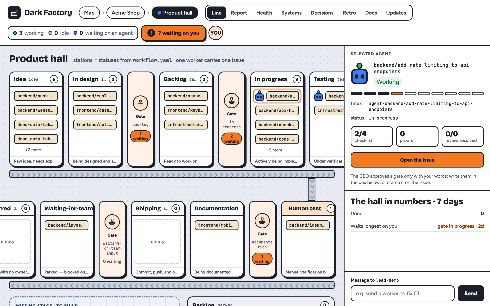
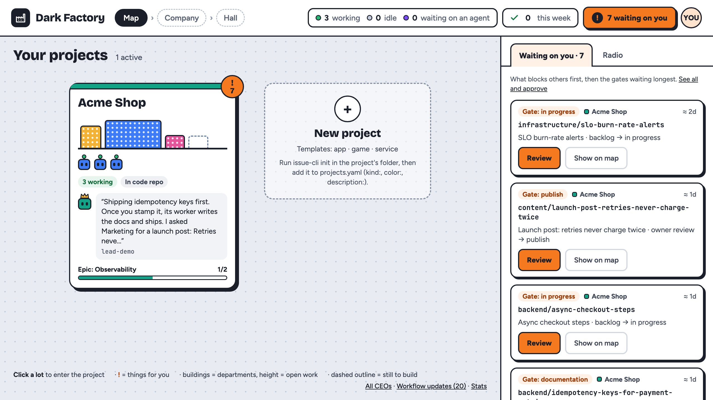
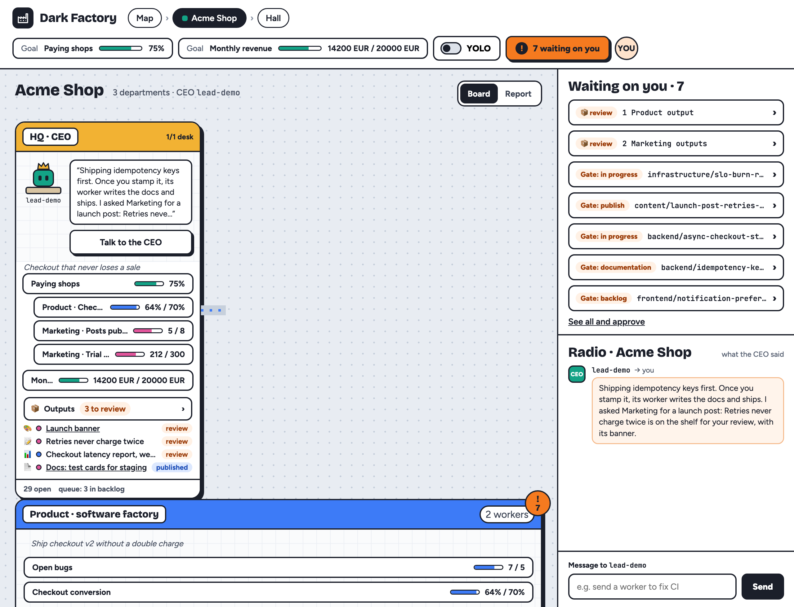
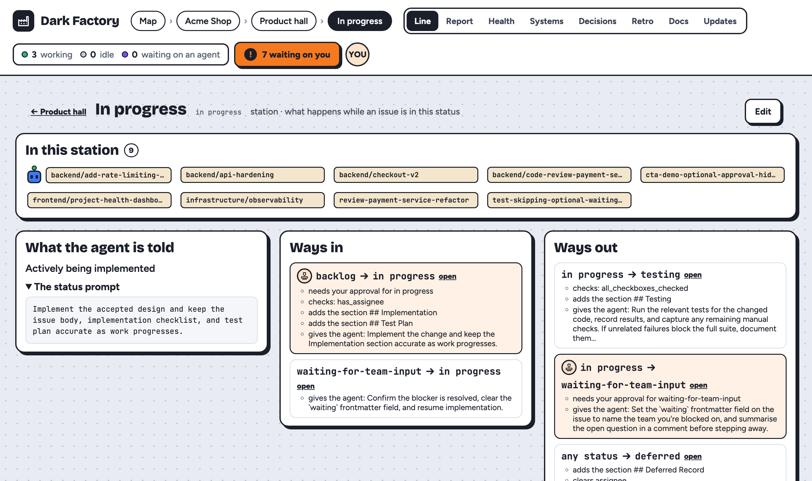
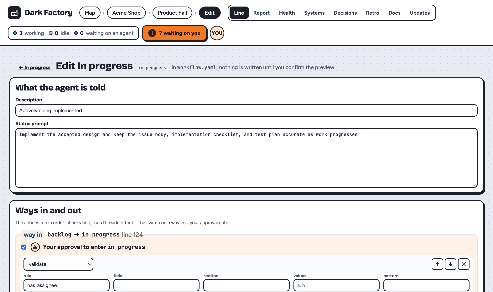
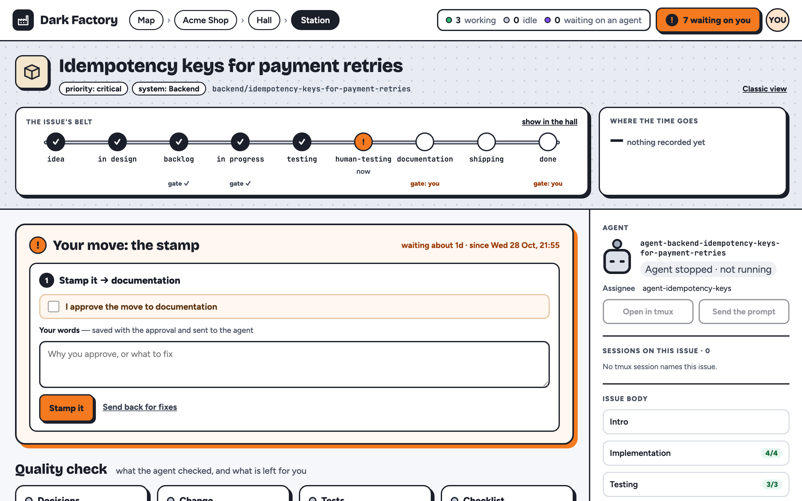
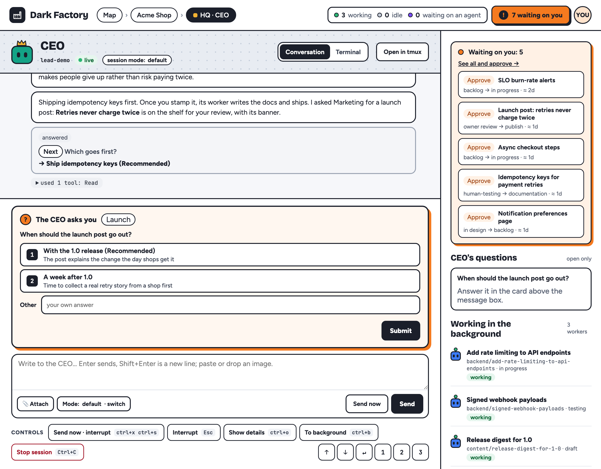
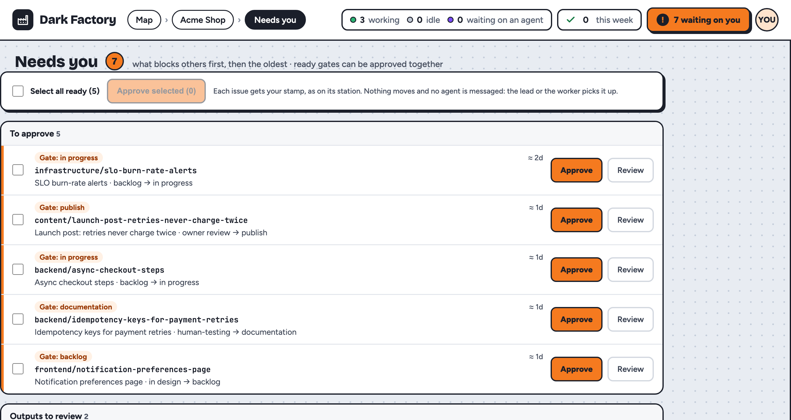
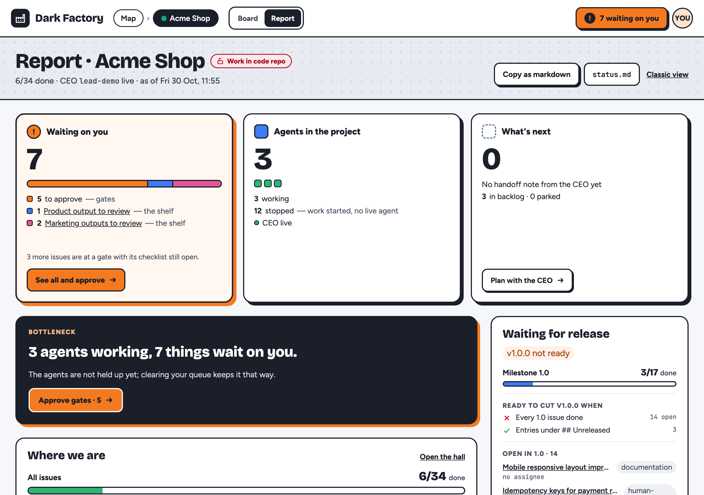

# Dark Factory

**Agents do the work. You make the decisions that matter.**

Dark Factory runs Claude Code and Codex agents through a process you write down, one issue at a time. It stops them at the moments you care about and shows you the whole factory on one board.

Dark Factory ships two binaries: `issue-viewer`, the board, and `issue-cli`, the agents' CLI.

<!-- Hero GIF slot (docs/images/hero.gif, not recorded yet): open an issue, press ▶ Claude; the agent's tmux pane runs `issue-cli start`; it blocks on a human approval; stamp it on the station; the agent carries on and the crate moves down the line. 20–30 s, 1280×720, under 5 MB. Until then the hall is the hero. -->


[Why](#why) · [How](#how) · [What](#what) · [Quickstart](#quickstart) · [An issue's life](#an-issues-life) · [Configuration](#configuration) · [Commands](#commands) · [What's new](#whats-new) · [Docs](docs/)

## Why

We believe agents should do the work and people should own the decisions.

Coding agents write good code. They are bad at knowing when to stop. Left alone, they skip the design, call untested work done, and ask you at the wrong moment or not at all. So you end up watching every step, and the time you saved goes into supervision.

It doesn't have to work that way. A team of people trusts its process, not each person's judgement at every minute. Agents can work the same way: inside a process you can read, with checks that hold, and a clear point where they stop and wait for you. You stop watching the agent and start running the factory.

The longer argument, vendor harness against workflow harness: [docs/why.md](docs/why.md).

## How

Five rules make that belief real.

- **One step at a time.** An issue moves forward only when the step's checks pass: a section written, its boxes ticked, a `tests:` comment posted, a shell command green. `issue-cli` refuses the move otherwise, and says what is missing.
- **You own the costly moments.** Gates such as `backlog → in progress` wait for your stamp. The agent asks you, ends its turn, and carries on when you approve.
- **Guidance arrives just in time.** Each status has its own short prompt, and every failed check prints the command that fixes it. There is no long manual for the agent to drift from.
- **Everything is files.** Issues are markdown, the process is one `workflow.yaml`, and git history is the audit log. No database, no SaaS, no API keys. The same workflow runs with Claude Code and Codex.
- **The factory runs itself, and you steer.** A project lead dispatches workers and relays their questions. Work lands on `main`, local CI re-tests it, and everything that needs you collects in one list.

## What

The **Workshop Board** is the viewer: a local web app that draws your projects as a small company. Everything below comes from the sample project (`make demo`).

### The map



The map (`/`) shows every project as a lot: departments as buildings, the workers on it, and what the CEO said last. The **!** badge counts what waits on you.

### The company: HQ and departments



Open a lot and you see the company. **HQ** is the CEO's room, with the business goals. **Product** is the software factory that runs `workflow.yaml`. `projects.yaml` can add departments such as Marketing, each with a mission, a role prompt, goals that roll up into HQ's, and its own workflow file (the bundled `content` template fits posts and pages). What a department makes lands on its **outputs shelf** (`issue-cli output add`) and waits for your yes. See [docs/departments.md](docs/departments.md).

### The hall: your workflow as a line

The **Product hall** (the picture at the top) draws `workflow.yaml` as a production line. Stations are statuses, gates are stamps, and each issue is a crate on the line. With local CI on, a CI scanner on the line shows whether `main` is green.



Click any part to open it. A station lists its issues, the prompt an agent gets there, and every way in and out with its checks. **Edit** changes it in place:



The editor shows a diff of `workflow.yaml` and runs the checks before anything is written. Saving commits that one file to `main` with your words in the message.

### The station: one issue



Each issue has a station (`/p/<project>/issue/<slug>`). The belt shows where it is and which gates are ahead. When it waits on you, **Your move** is on top: stamp it with your words, or send it back for fixes. The Timeline tab shows where the time went (agent working, waiting on you, idle, rework). The Evidence tab links each acceptance criterion to the test or playtest that proves it.

### The CEO chat



You talk to one session, the project lead, here called the CEO (`issue-cli lead spawn`, or **Start CEO** on the company page). The chat at `/p/<project>/lead` reads the lead's transcript, so each reply is one whole message with its markdown rendered. When the CEO asks a question, it becomes a card you answer on the page. Paste, drop or attach images. The CEO grooms ideas with you, dispatches workers, relays their questions, and stamps a gate only after you said yes in the chat (`issue-cli approve` records your words). Workers each own one issue in their own git worktree and never stamp a gate. Setup and routing: [docs/patterns/lead-session.md](docs/patterns/lead-session.md).

### Needs you



Every "waiting on you" count opens one list (`/p/<project>/needs-you`, or `/needs-you` across projects): gates, red CI, playtests and checks to run, open questions and outputs to review, with what blocks others first. Gates that only miss your stamp can be approved together, after one confirm.

### The Report



The Report (`/p/<project>/status`, also `status.md`) is the stand-up: what waits on you, who is working, the bottleneck, where the milestone stands and what is ready to release.

### YOLO mode

When you step away, `issue-cli yolo on --until 4h --quote "<your words>"` lets gates pass without you for that window once nothing else is missing. Each pass waits in an after-the-fact list for your review, and red CI for more than 30 minutes turns YOLO off by itself. See [docs/Workflow/yolo.md](docs/Workflow/yolo.md).

### Shipping: one main, local CI

- **`main` is the only integration branch.** A worker merges `main` into its branch, runs your checks, and fast-forwards the local `main`. Agents never push.
- **Local CI** re-tests `main` after every merge. An opt-in `ci:` block in `workflow.yaml` names the commands, the viewer runs them in tmux and keeps each run under `.ci/`. A red run shows in the hall's CI scanner, on the Report, on the issues that landed and in the lead's chat. See [docs/workflow.md#local-ci](docs/workflow.md#local-ci).
- **A release per milestone.** Agents add their change under `## Unreleased` in the changelog. The Report's **Waiting for release** card says when the milestone is ready to cut. The lead cuts it and pushes on your go-ahead ([releases](docs/roadmap.md#cutting-a-release-candidate-soak-publish)). With `privacy.code: snapshots` the dev history stays in a private repo and the public one gets **one commit per release**, its changelog section as the message: `issue-cli release setup --dev <private repo url>` once, then `release publish <version>` (`--dry-run` shows the commit first).

### Under the board

| Piece | What it is |
|---|---|
| **Issues** | One markdown file per issue, `issues/<System>/<slug>.md`. Frontmatter holds `title`, `status`, `system`, `version`, `priority`, `labels`, `assignee` and any custom key. The body grows section by section; comments sit in a hidden block at the end. See [docs/issue-format.md](docs/issue-format.md). |
| **Workflow** | `workflow.yaml`: statuses with a prompt each, transitions with ordered actions (`validate`, `require_human_approval`, `append_section`, `inject_prompt`, `set_fields`), optional side states and per-system overlays. |
| **issue-cli** | How agents (and you) move issues: `start`, `check`, `comment`, `transition`. It enforces the workflow and prints `Requires:` / `Will:` before every step. |
| **issue-viewer** | The Workshop Board above. One server hosts many projects and listens on localhost only. |
| **Workers** | The lead, or `issue-cli dispatch <slug>`, starts Claude or Codex in tmux (`agent-<slug>`) with a briefing built from the workflow. With `worktree: true` each issue gets its own worktree and branch. |

A transition says what must be true before the move and what happens after it:

```yaml
transitions:
  - from: "backlog"
    to: "in progress"
    actions:
      - type: require_human_approval     # waits for your stamp
        status: "in progress"
      - type: append_section             # the next step starts from a checklist
        title: "Implementation"
        body: |
          - [ ] Happy path
          - [ ] Edge cases
  - from: "testing"
    to: "human-testing"
    actions:
      - type: validate
        rule: section_checkboxes_checked
        section: "Testing"
      - type: validate
        rule: "has_comment_prefix: tests:"
```

Checks include `body_not_empty`, `has_section`, `section_min_length`, `section_checkboxes_checked`, `has_comment_prefix`, `field_in`, `has_label`, `has_pr_url`, `linked_issue_in_status`, `no_todo_markers` and `command_succeeds` (a shell command; opt in with `allow_shell: true`). `issue-cli process schema` prints them all. Full reference: [docs/workflow.md](docs/workflow.md).

A blocked step tells the agent exactly what to do next:

```text
$ issue-cli transition backend/add-rate-limiting-to-api-endpoints --to testing --dry-run
== Dry run: in progress → testing ==
✗ 1 unmet requirement(s):
  - [validator] Validate all checkboxes are checked
      2 of 4 boxes still open:
      R1   Token bucket algorithm for per-user limits
      R2   Configurable limits per endpoint
      Tick the ones that are done (ids, several at once):
      issue-cli check backend/add-rate-limiting-to-api-endpoints R1 R2
Nothing was changed.
```

More of what the board does: manual checks as [playtests](docs/patterns/playtest/README.md) and [guided check scripts](docs/patterns/guided-check-scripts.md), `issue-cli retrospective` notes on the workflow, custom buttons (`issue_actions`, `project_actions`), and stats and health over time ([docs/workflow-stats.md](docs/workflow-stats.md)). Terminals, shared tmux sessions, models and worktrees: [docs/agent-dispatch.md](docs/agent-dispatch.md).

## Quickstart

You need Linux or macOS, `git`, `tmux`, and the `claude` or `codex` CLI on your `PATH` (Go 1.25+ to build from a clone). Nothing else: `mem-guard`, `rtk` and i3, named elsewhere in the docs, are optional.

```bash
# 1. Install issue-cli (the agent CLI) and issue-viewer (the board) into ~/.local/bin
curl -fsSL https://raw.githubusercontent.com/kacperwerema/dark-factory/main/install.sh | bash
#    or with Go:
go install github.com/kacperwerema/dark-factory/cmd/issue-cli@latest github.com/kacperwerema/dark-factory/cmd/issue-viewer@latest
#    or both from a clone:
git clone https://github.com/kacperwerema/dark-factory && cd dark-factory
GOBIN="$HOME/.local/bin" make install

# 2. A project: issues/, docs/, workflow.yaml and its entry in projects.yaml
issue-cli project init ~/src/shop --name "Shop" --config ~/.config/ai-workflow-engine/projects.yaml
cd ~/src/shop && git init && git add -A && git commit -m "Start the shop"

# 3. The board on http://localhost:8080 (it listens on 127.0.0.1 only)
issue-viewer -config ~/.config/ai-workflow-engine/projects.yaml

# 4. In another shell: a first issue, and a worker on it
issue-cli --project shop create --title "Add a dark mode toggle" --system UI
issue-cli --project shop dispatch ui/add-a-dark-mode-toggle --quote "try the dark mode toggle"
tmux attach -t agent-ui-add-a-dark-mode-toggle
```

The config folder `~/.config/ai-workflow-engine/` and the state folder under `~/.local/state/` keep the project's earlier name, `ai-workflow-engine`, like a few env vars ([Legacy names](docs/getting-started.md#legacy-names)).

The worker reads the workflow with `issue-cli process`, works the issue and stops at the first gate. Sign in on the board as the owner (**YOU**, then **Show me a code**) to approve it. Or press **Start CEO** on the company page and let the project lead dispatch workers for you. [Getting started](docs/getting-started.md) walks the same steps one by one, with a department from a template, what each optional tool adds, and what to do when a step fails.

Just looking? Clone the repo and run `make demo` to open Acme Shop, the sample project in these pictures.

## An issue's life

One issue through the `development` template, abridged:

```text
you    issue-cli create --title "Rate-limit the login endpoint" --system API
agent  issue-cli start <slug>                            claims it, prints the checklist and the next step
agent  issue-cli transition <slug> --to "in design"      body_not_empty passes; Design section appended
agent  … writes the design, ticks its boxes: issue-cli check <slug> D1 D2 D3
agent  issue-cli transition <slug> --to "backlog"
       approval for "backlog" is missing: asks you, ends its turn
you    stamp it on the station or in Needs you                      ← gate 1: the design
agent  moves to backlog, issue-cli start <slug>, asks for the go-ahead, ends its turn
you    stamp the next gate                                          ← gate 2: start building
agent  builds, tests, posts "tests: go test ./... green", moves to testing, then human-testing
you    judge the steps a machine can't (make playtest), stamp it    ← gate 3: it works
agent  documentation → shipping
you    stamp the last gate                                          ← gate 4: ship it
agent  → done, then files a retrospective on the workflow
```

## Configuration

**`projects.yaml`** tells the board about your projects (one server, many projects):

| Key | Purpose |
|---|---|
| `name`, `slug` | Display name and URL slug (`/p/<slug>/`) |
| `issues`, `docs`, `workflow`, `workdir` | Where the files live; `workdir` is where agents start |
| `terminal` | Command that opens a window on a worker's session, with `{{session}}`, `{{project}}`, `{{name}}`, `{{role}}`, `{{window}}` substituted; `none` for headless. Unset means i3 + alacritty where `i3-msg` is on `PATH`, headless elsewhere |
| `lead_terminal`, `lead_window_session`, `lead_window` | What opens for the project lead: unset or `none` is headless, `tmux-window` adds the lead as a background tab in your own tmux session (`lead_window_session`, optionally at index `lead_window`), anything else is a command like `terminal` ([docs/agent-dispatch.md](docs/agent-dispatch.md#lead-terminal)) |
| `tmux_session` | Run every agent of the project as a window in one shared session |
| `tmux_session_per_project` | Top level: give each project one session for its lead and workers (with `terminal: none`, nothing opens a window) |
| `agent_model_source`, `agent_models` | `project` pins a model per agent (`claude`, `codex`); `global` (default) leaves it to the agent |
| `repo`, `supports_github`, `import_status` | GitHub sync and auto-close ([docs/github-integration.md](docs/github-integration.md)) |
| `telemetry` | `false` turns off issue-cli's local, names-only usage log ([docs/CLI/telemetry.md](docs/CLI/telemetry.md)) |
| `company`, `departments` | HQ's and each department's mission, role prompt, goals and own workflow file ([docs/departments.md](docs/departments.md)) |

**`workflow.yaml`** is the process: `statuses`, `transitions`, `systems` (per-system overlays), `types` (per-type paths), `board`, `scoring`, `worktree`, `worktree_setup`, `worktree_sparse_exclude`, `allow_shell`, `issue_actions`, `project_actions`, `leads` (the lead's brief), `ci` (local CI), `playtest` (who runs playtests) and `workbench` (changelog, project pages, metric files). Start from a template with `issue-cli init`, edit a station from the hall or the file as text (`issue-cli workflow upgrade` pulls in template changes), or print the schema with `issue-cli process schema`. See [docs/workflow.md](docs/workflow.md) and [docs/board-configuration.md](docs/board-configuration.md).

## Commands

| | |
|---|---|
| `issue-cli process` | Learn the project's workflow (agents run this first) |
| `issue-cli next` | Find the next issue to work on |
| `issue-cli start <slug>` | Claim an issue and get its checklist and next step |
| `issue-cli transition <slug> --to <status>` | Move one step (`--dry-run` lists what's missing) |
| `issue-cli check <slug> D1 D2` | Tick checkboxes by id |
| `issue-cli comment <slug> --text "…"` | Add a comment (`tests:`, `docs:`, `progress:` …) |
| `issue-cli context <slug>` | Everything about one issue (alias `show`) |
| `issue-cli list`, `search`, `stats` | Find and summarise issues |
| `issue-cli retrospective <slug>`, `report-bug` | Feedback on the workflow and the tool |
| `issue-cli lead spawn`, `approve <slug>` | Start the project lead; the lead records an approval you gave in chat |
| `issue-cli dispatch <slug> --quote "…"` | Start one worker on an issue, with your words |
| `issue-cli status` | The project's stand-up from the running viewer |
| `issue-cli ci status` | Local CI: where `main` stands and the recent runs |
| `issue-cli yolo on --until 4h --quote "…"` | Let gates pass for a window; review them afterwards |
| `issue-cli output add`, `outputs`, `goals`, `department show` | A department's outputs shelf, goals and role |
| `issue-viewer -config projects.yaml [-port 8080]` | Start the viewer (localhost only; `-host` to change it) |

All commands: `issue-cli help`, or [docs/CLI/overview.md](docs/CLI/overview.md).

## What's new

- **v0.60, the public release:** one name, Dark Factory, and one module, `github.com/kacperwerema/dark-factory` (`go install github.com/kacperwerema/dark-factory/cmd/issue-cli@latest`); install from this repo; the viewer lives in `cmd/issue-viewer`; CI runs on every public snapshot; outside pull requests are asked to open an issue first.
- **v0.59, the floor and the critic:** the company page is one fixed floor with a chat link on every room; a fresh critic reads the work before a gate; one clarify round per design; a post-mortem at close; a check still red after four fix rounds becomes a question for you.
- **v0.58, departments that report:** a markdown output on the shelf opens as a document you comment on in the margin; HQ links to a one-minute report on the whole company; each room shows its spend and budget; department health joins the daily snapshot; a group's lead plans and reports its week; groups nest; declared connections say who may ask whom; workflows declare `evals:` so a workflow change gets a benchmark verdict.
- **v0.57, departments that run:** add a department from a template, a lead per department, recurring jobs, connectors to outside tools, the factory benchmark and the experiment loop, and auto-start (your standing start, one worker at a time while memory is low).
- **v0.56, edit the workflow from the hall:** open a station in the Product hall and press **Edit** to change its prompt, its ways in and out and their gates, with a preview and checks before the one-file commit. This README and its pictures now show the Workshop Board.
- **v0.55, the Workshop Board and departments:**
  - The viewer's new look: a map of the company, HQ and the department rooms, the Product hall (the workflow.yaml line, where any station, gate or the CI scanner opens to show what is inside), the Report at `/status` and the station for each issue.
  - The **CEO chat** (`/p/<project>/lead`): you talk to the project lead from the board. Each reply is one message with its markdown rendered, questions are cards you answer on the page, and you can paste, drop or attach images.
  - **Needs you** (`/p/<project>/needs-you`, or `/needs-you` across projects): everything that waits on you in one list, with *Approve selected* for the gates that only need your stamp.
  - **▶ Run playtest** from the page you are on. A `playtest: owner|agents|off` key decides who runs playtests.
  - **YOLO mode**: `issue-cli yolo on --until …` lets gates pass for a set window, and you review them afterwards.
  - **Departments**, each with its own workflow file, mission, prompt and goals, and an outputs shelf of what it made (`issue-cli output`).
- **v0.54, project health:** daily health snapshots (size, speed, tests, storage, lint), a derived score and an agent's opinion on the Health page, trends on the Stats page, and privacy badges for private repos.
- **v0.53, Safe core:** local CI on the integrated `main`, the viewer bound to localhost with cross-origin writes refused, and graceful shutdown.
- **v0.52, project status pages:** your own HTML pages in the viewer, sandboxed, and one lead per project that leads the epics too.
- **v0.51, one terminal:** every project's lead and workers as windows of one tmux session.

Every change is in [cmd/issue-cli/CHANGELOG.md](cmd/issue-cli/CHANGELOG.md) and `issue-cli process changes`.

## Status and roadmap

Version 0.60 (November 2026). Pre-1.0 and moving fast. Each version is one milestone with one focus, released when its last issue ships. Renamed keys keep a deprecated alias (`actions:` still works next to `issue_actions:`).

Next, in order, from [docs/roadmap.md](docs/roadmap.md):

- **A fast, robust server** on big projects
- **Setup in minutes:** from install to a working board without hand-editing config
- **Gates you can trust:** every check measures what it says
- **One landing page:** the Workshop Board everywhere; the classic pages are retired

## Contributing

This repository gets one snapshot per release; day-to-day work happens elsewhere. Issues are welcome at [github.com/kacperwerema/dark-factory/issues](https://github.com/kacperwerema/dark-factory/issues): bug reports, questions, ideas. Pull requests are not merged here, so open an issue instead and describe the change.

To build and change it in your own copy: `make build` and `make build-cli` build the two binaries, `make validate` runs go vet, the test suite and a coverage floor on `issue-cli`, and `make demo` starts the board on the sample project. `make readme-shots` retakes this README's pictures from a staged copy of the demo (`docs/images/shots.yaml` lists them).

## Licence

[PolyForm Noncommercial 1.0.0](LICENSE.md): free for any noncommercial use (personal projects, research, study, hobby, charities, schools, public bodies), including changing and sharing it. Commercial use needs a separate written commercial license from the licensor named in [LICENSE.md](LICENSE.md)'s Required Notice lines. The terms have no expiry or change date.

The bundled fonts in `internal/viewer/static/fonts/` keep their own SIL Open Font License.
